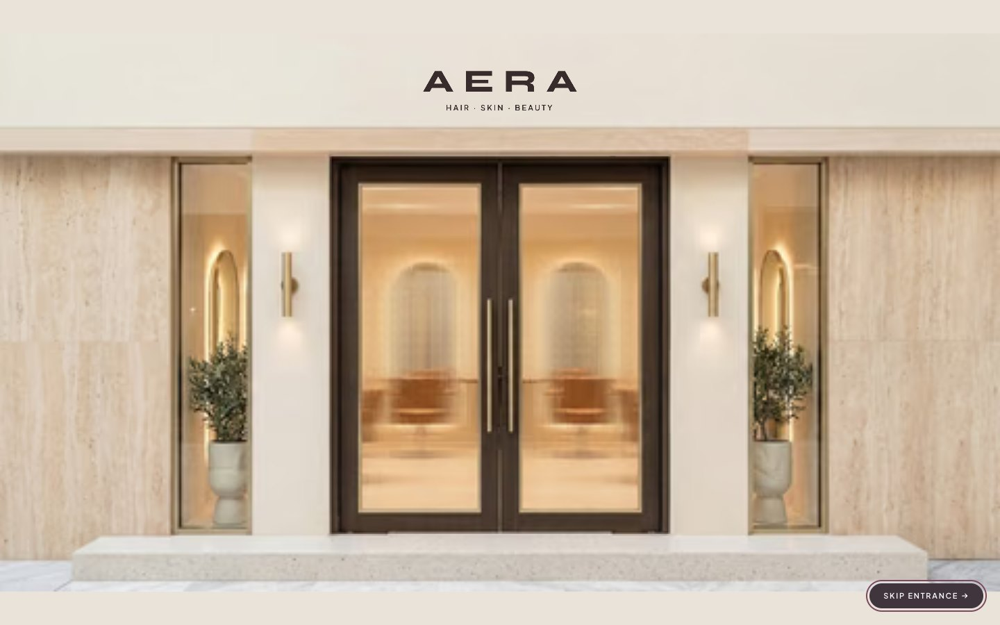
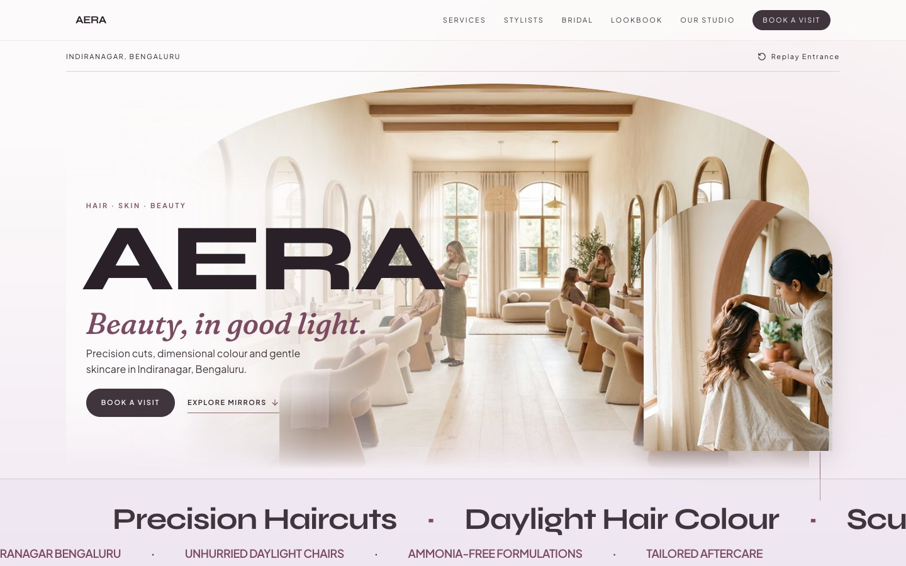
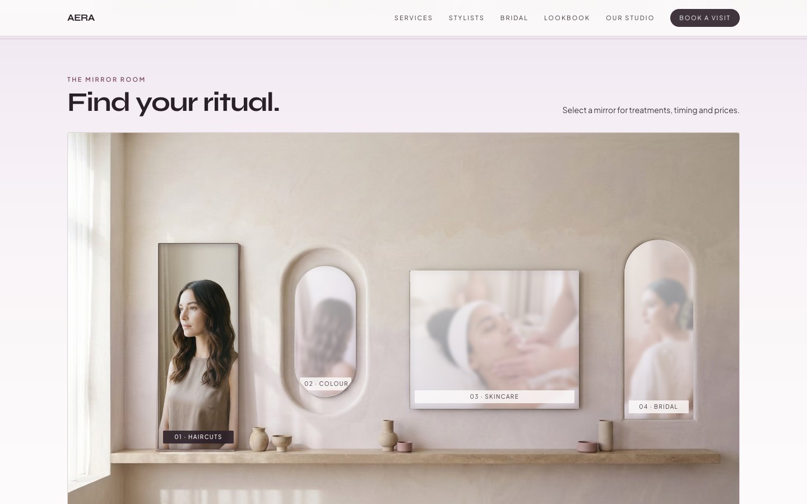
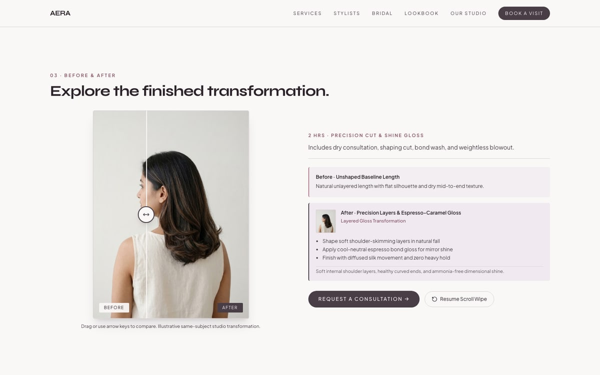
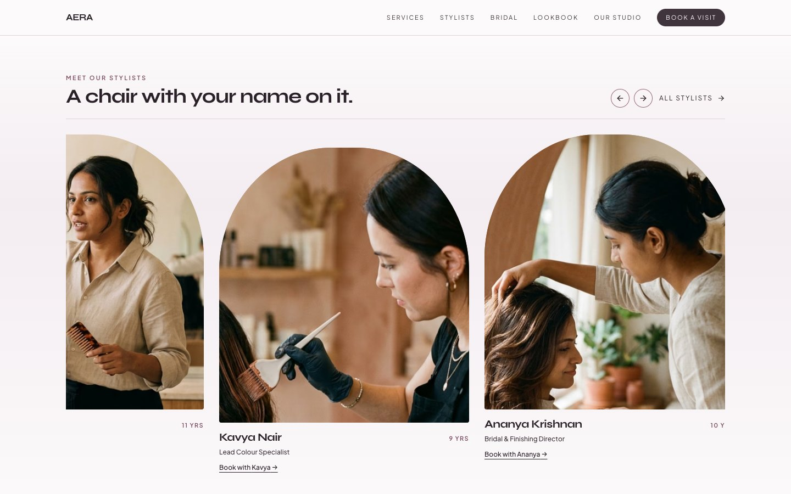
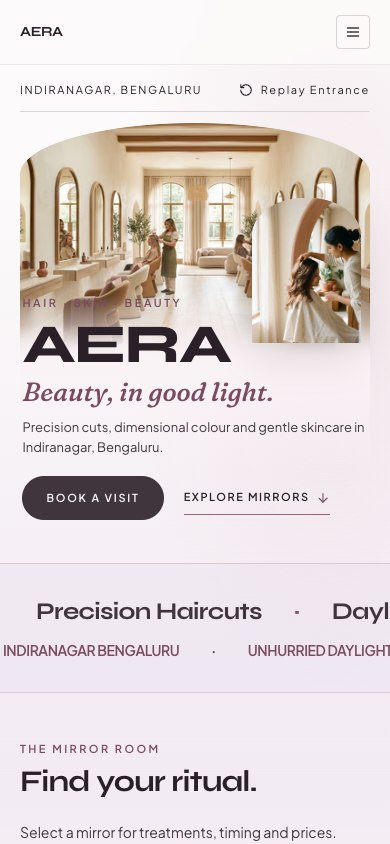

# AERA Beauty Studio

**Soft-luxury interactive beauty studio showcase and modular multi-route salon web application** — engineered with React 19, TypeScript, Vite 7 SSR prerendering, Tailwind CSS v4, GSAP 3, Lenis, and accessibility-audited motion choreography.

> **Portfolio Showcase Notice:** AERA Beauty Studio demonstrates fictional Bengaluru salon data (`₹ INR`). All booking flows, date validation, and WhatsApp concierge builders preview strictly in client memory (`demoMode: true`, `publishLocalBusinessSchema: false`, `allowIndexing: false`) without transmitting appointments or publishing unverified local business schema.

---

## Table of Contents

- [Project Objectives & Creative Vision](#project-objectives--creative-vision)
- [Current Status & Milestone History](#current-status--milestone-history)
- [Signature Animations & Interactive Experiences](#signature-animations--interactive-experiences)
- [Screenshots (V4 Phase 2)](#screenshots-v4-phase-2)
- [Supported Routes & Features](#supported-routes--features)
- [Technology Stack](#technology-stack)
- [Architecture Overview](#architecture-overview)
- [Local Installation & Development](#local-installation--development)
- [Production Build & Preview](#production-build--preview)
- [Testing & Accessibility Verification](#testing--accessibility-verification)
- [Commercial Customization (`src/config/*`)](#commercial-customization-srcconfig)
- [Media Licensing & Portfolio Disclosure](#media-licensing--portfolio-disclosure)
- [Known Limitations & Roadmap](#known-limitations--roadmap)

---

## Project Objectives & Creative Vision

AERA Beauty Studio was built as a flagship portfolio project demonstrating interactive craft alongside maintainable, white-label commercial architecture:

1. **Quiet Soft-Luxury Editorial Aesthetic**: Porcelain (`#FAF8F7`) and alabaster (`#F2EEF1`) breathing room paired with soft lilac (`#E7DFEB`), dusty rose (`#D8ADB6`), muted berry accents (`#844D60` / `#B77F91`), and plum ink typography (`#493D46` / `#2A2128`), intentionally distinct from heavy gold/burgundy retail templates.
2. **Typography Pairing**: Geometric sculptural display (`Syne Variable`) balanced with restrained `Fraunces Variable` italic accents and clean `Plus Jakarta Sans Variable` UI copy with `tabular-nums` currency alignment (`₹ INR`).
3. **Environmental Storytelling (~70% calm layout / ~20% refined motion / ~10% signature moments)**: Architectural salon doors open straight into the sunlit salon hero; studio services live behind frosted mirror veils rather than monotonous boxes.
4. **White-Label Configurability & Engineering Rigor**: All brand copy, studio coordinates, services, lookbook plates, team artisans, bridal packages, media metadata, and commercial video provenance live cleanly inside `src/config/*`, backed by unit tests, static SSR prerendering, native modal focus management, and automated Playwright + axe audits.

---

## Current Status & Milestone History

- **Current Milestone** — **V4 Phase 3** on `feat/v4-motion-craftsmanship`. [Phase 3 implementation and verification](docs/V4_PHASE3.md).
- **Milestone Progression Preserved in Git**:
  - **V1 (`v1-initial-baseline`)**: Core multi-route application scaffold, initial closed-door entrance, living mirror room, responsive `sharp` media pipeline, and Vitest/Playwright suite.
  - **V2 (`feat/visual-refinement-v2` / `v2-baseline`)**: Pinned split transformation comparison, extended studio imagery, and subpage editorial polish.
  - **V3 (`feat/visual-refinement-v3` / `v3-audited-baseline`)**: Shift to contemporary `Syne` + `Plus Jakarta Sans` + Porcelain/Lilac palette, vertical reels strip, and independent Codex audit baseline (`6.1/10`).
  - **V4 Phase 1 (`fix/v4-technical-foundation`)**: Codex technical remediation resolving SSR route hydration, `/404` status handling, fail-open `#aera-entrance` resilience, native modal stacking (`StudioDialog`), single-reel playback arbitration, touch-friendly comparison sliders, and Web Vitals / axe baseline.
  - **V4 Phase 2 (`v4-phase2-baseline`)** — Architectural entrance, matched illustrative Before/After pair, shorter homepage, and mobile reels rail.
  - **V4 Phase 3 (`feat/v4-motion-craftsmanship`)** — Opaque photographic door leaves, a layered daylight hero, tighter scroll choreography, reversible Process refraction, a native stylist rail and default reel cards that link to the source clips.

---

## Signature Animations & Interactive Experiences

- **Closed-to-Open Architectural Entrance** — The prerendered scene crops the façade and both opaque leaves from `doors-closed`. A 3D hinge swing and forward push reveal the live homepage in about 2.44 seconds. The native dialog supports Escape, Skip Entrance, once-per-session playback, explicit replay and reduced-motion bypass.
- **Interactive Living Mirror Room (`LivingMirrorWall.tsx`)**: Four architectural mirror hotspots embedded across the plastered salon wall (`Haircuts`, `Colour`, `Skincare`, `Bridal`). Selecting or activating a mirror clears its frosted veil to display tailored treatment highlights, duration, and starting `₹ INR` pricing.
- **Pinned Process** — A `160vh` desktop scroll region with a sticky composition links three treatments through an organic wipe and directional SVG refraction. Touch controls step through the treatments on mobile.
- **Before & After** — The `146vh` desktop scroll wipe traverses the illustrative portrait pair. Pointer drag and keyboard controls hold the chosen position until the visitor resumes the wipe or scrolls away. Vertical swipes retain native scrolling.
- **Opposing Kinetic Typography** — Scroll position moves the two lines in opposite directions between the hero and mirror room.
- **Stylist and Reels Rails** — Stylist portraits travel horizontally on desktop and mobile through native overflow. The reels use a swipeable mobile rail. With preview footage enabled, the player loads on demand, pauses offscreen or in a background tab, and allows one active video at a time.
- **Chair Sanctuary & Native Modal Enquiry (`ChairSanctuarySection.tsx`, `EnquiryDrawer.tsx`, `StudioDialog.tsx`, `WhatsappPreviewModal.tsx`)**: Accessible multi-step appointment preview drawer validated with Zod and Bengaluru (`Asia/Kolkata`) date constraints, plus a live URL-encoded WhatsApp message composition modal with nested focus restoration.

---

## Screenshots (V4 Phase 2)

The Phase 3 comparison and recordings are generated locally under `audit-captures/v4-phase3/`. The images below document the Phase 2 checkpoint.

| Entrance (Closed Fluted Glass) | Desktop Hero (`1440×900`) |
| :---: | :---: |
|  |  |

| Living Mirror Room | Matched Before & After Comparison |
| :---: | :---: |
|  |  |

| Editorial Stylists Showcase | Studio Reels (`AERA in Motion`) | Mobile Hero (`390×844`) |
| :---: | :---: | :---: |
|  |  |  |

---

## Supported Routes & Features

All routes are client-hydrated via React Router v7 and pre-rendered at build time into static directory indexes plus a dedicated HTTP `404` page:

| Route | Component | Highlights |
| :--- | :--- | :--- |
| `/` | `HomePage` | Architectural entrance, asymmetric Hero, Opposing Ethos, Living Mirror Wall, Pinned Process, Matched B/A Comparison, Artisans Grid/Rail, Studio Reels, and Chair Sanctuary booking finale. |
| `/services` | `ServicesPage` | Filterable treatment menu (supports URL `?pillar=` query hydration), length/density INR tiers, duration tags, patch-test notes, and scoped enquiry launch. |
| `/team` | `TeamPage` | Specialist profiles (`Meera Rao`, `Kavya Nair`, `Ananya Krishnan`), specialty tags, experience years, and artist-prefilled booking flow. |
| `/bridal` | `BridalPage` | Private Bridal Suite showcase, 12-week-to-wedding-day preparation timeline, and curated multi-event bridal packages (`₹38,000+`). |
| `/gallery` | `GalleryPage` | Mood-filtered lookbook (`All`, `Haircuts`, `Hair Colour`, `Skincare`, `Bridal`) with slide-over `LookbookDossierDrawer` & consultation handoff. |
| `/about` | `AboutPage` | Daylight studio philosophy, botanical low-ammonia standards, Indiranagar showcase coordinates, and studio hours. |
| `/enquire` | `EnquirePage` | Standalone 3-step Demo Appointment Request page with Zod validation, preview confirmation, and WhatsApp composer preview. |
| `/404` | `NotFoundPage` | Prerendered `dist/404.html` returned with HTTP `404` by Vite preview middleware and host rules. |

---

## Technology Stack

- **Core**: React `19.0`, TypeScript `5.8`, Vite `7.3`, Tailwind CSS v4 (`@tailwindcss/vite`)
- **Routing & Build-Time SSR**: React Router v7 (`BrowserRouter` / `StaticRouter`), custom Vite preview middleware (`vite.config.ts`), and `scripts/prerender.mjs`
- **Animation & Scroll**: GSAP `3.12` + `@gsap/react`, Lenis `1.2` (`autoRaf: false` ticked inside `gsap.ticker` with `gsap.ticker.lagSmoothing(0)`)
- **Validation & UI Primitives**: Zod `4.6`, native `<dialog>` stacking (`StudioDialog`), Lucide icons
- **Fonts**: Self-hosted `@fontsource-variable/syne`, `@fontsource-variable/fraunces`, `@fontsource-variable/plus-jakarta-sans`
- **Media Optimization**: `sharp` `0.35` (`scripts/optimize-media.mjs`) + local `ffmpeg` H.264 540×960 fast-start MP4 transcoding
- **Testing & Quality**: Vitest `5.1`, Playwright `1.51`, `@axe-core/playwright` `4.14`

---

## Architecture Overview

```text
├── index.html                        # Native prerendered #aera-entrance dialog & bounded fail-open bootstrap
├── public/media/                     # Compiled AVIF/WebP sets and ignored local reel inputs
├── scripts/
│   ├── optimize-media.mjs            # Generates responsive AVIF/WebP + LQIP data URIs -> src/config/media.generated.ts
│   ├── prerender.mjs                 # Prerenders routes -> dist/<route>/index.html, 404.html, robots.txt (+ sitemap.xml if enabled)
│   ├── generate-contact-sheet.mjs    # Utility to inspect all visual assets & reel posters in one grid
│   └── compare-v3-v4.mjs             # Utility comparing V3 vs V4 Playwright screenshot pairs
├── src/
│   ├── assets/media/raw/             # Source visual photography (compiled via optimize:media)
│   ├── config/                       # Single source of truth for multi-client white-label customization
│   ├── components/
│   │   ├── layout/                   # Header, Footer, PageShell, StudioDialog, StudioPicture, SilkVeilTransition, MobileConciergeBar
│   │   ├── sections/                 # Hero, LivingMirrorWall, TransformationSection, TransformationComparison, Artisans, Reels, Sanctuary
│   │   └── interactive/              # EnquiryDrawer, EnquiryForm, LookbookDossierDrawer, WhatsappPreviewModal
│   ├── lib/                          # StudioContext, SmoothScrollProvider, routePaths, routePages, seo, booking, format
│   ├── pages/                        # 8 route pages (Home, Services, Team, Bridal, Gallery, About, Enquire, NotFound)
│   ├── entry-server.tsx              # SSR renderRoute entrypoint
│   └── main.tsx                      # Selective hydrateRoot / createRoot client entrypoint
└── tests/
    ├── unit/config-and-utils.test.ts # Config, INR format, WhatsApp/SEO demo guards, video provenance & route checks
    └── e2e/
        ├── technical-foundation.spec.ts # Regression tests (SSR, 404, entrance resilient timeouts, modal focus, reel retry)
        └── aera-visual-audit.spec.ts    # Desktop (1440×900), Laptop (1280×800), Tablet (768×1024), Mobile (390×844) + axe audit
```

---

## Local Installation & Development

**Prerequisites**: Node.js `22.12+`, `24+`, or `26+` (verified on Node `v24.13.0` & npm `11.6.2`).

```bash
# Install exact locked dependencies
npm ci

# Start Vite development server
npm run dev
```

If you add or replace images in `src/assets/media/raw/`, recompile optimized responsive sets and metadata before building:

```bash
npm run optimize:media
```

---

## Production Build & Preview

```bash
# 1. Type-check
npm run typecheck

# 2. Build client bundle, SSR bundle, and static HTML route outputs into dist/
npm run build

# 3. Serve built production dist/ cleanly (with custom 404 status middleware)
npm run preview -- --host 127.0.0.1 --port 4173 --strictPort
```

For production static hosting, serve `dist/` directory indexes directly and configure the host to serve `dist/404.html` with HTTP `404` on unknown routes rather than rewriting every path to `/index.html` with `200`. Review CSP hashes (`#aera-entrance` inline bootstrap in `index.html`) before enforcing strict Content-Security-Policy headers.

---

## Testing & Accessibility Verification

```bash
# Unit & configuration integrity tests (Vitest)
npm test

# Install Chromium binary once if running E2E in a fresh environment
npx playwright install chromium

# Full multi-viewport Playwright E2E, functional regressions & axe audit
CI=1 npm run test:e2e
```

See the [Phase 3 verification results](docs/V4_PHASE3.md#verification) for the Chromium route audit, regressions and repeatable lab measurements.

---

## Commercial Customization (`src/config/*`)

Rebranding AERA for a live salon client requires editing config files rather than rewriting UI sections:

1. **`src/config/studio.config.ts`**:
   - Set `brand`, `locale`, `location`, `hours`, and `navigation`.
   - Switch `whatsapp.demoMode` to `false` and provide real `verifiedDigits` only when authorized to dispatch client WhatsApp inquiries.
   - Replace placeholder `seo.siteUrl` (`https://aera-beauty-studio.example`) and toggle `seo.publishLocalBusinessSchema` / `seo.allowIndexing` to `true` only once verified business identity, physical address, and hosting domain are live.
2. **`src/config/theme.config.ts`** & **`src/styles/index.css`**: Adjust semantic tokens (`porcelain`, `alabaster`, `softLilac`, `dustyRose`, `berryInk`, `plumInk`, `aubergine`).
3. **`src/config/services.config.ts`**, **`team.config.ts`**, **`bridal.config.ts`**, **`booking.config.ts`**, **`lookbook.config.ts`**: Update categories, ₹ INR pricing tiers, team specialties, bridal timelines, and Before/After mappings (`afterMediaId` should only be populated with a matched same-subject result).
4. **`src/assets/media/raw/`** + **`src/config/media.config.ts`** + **`src/config/videos.config.ts`**: Drop in photography, run `npm run optimize:media`, and point video reels to client-owned MP4s and posters.

---

## Media Licensing & Portfolio Disclosure

- **Studio reel previews** — The default build uses AERA stills and links to four individually sourced Mixkit clips. For an authorized local playback preview, place the named MP4s and optional JPEG posters in the ignored `public/media/local-reels/` directory and build with `AERA_ENABLE_LOCAL_REELS=1 npm run build`. The [Phase 3 reel ledger](docs/V4_PHASE3.md#reel-provenance) records contributors, file names and the unresolved standalone redistribution rights.
- **Editorial Showcase Photography (`src/assets/media/raw/*`)**: All `23` source showcase photographs (including the matched `before-hair` → `after-hair-matched` comparison pair) were custom-generated for this conceptual portfolio showcase using Google generative imaging tooling rather than third-party scraped stock. Before commercial client launch, replace them with licensed or studio-photographed salon assets.
- **No Unverified Claims**: Zero fabricated customer reviews, ratings, press badges, live chair availability claims, or verified `HairSalon` JSON-LD emissions appear in the application while `demoMode` is active.

---

## Known Limitations & Roadmap

### Current Limitations
- **Specialist Team Photography**: Server image-generation capacity (`HTTP 503 UNAVAILABLE`) prevented adding a distinct fourth portrait for `Rhea Deshmukh`; the verified team currently presents 3 artisans (`Meera Rao`, `Kavya Nair`, `Ananya Krishnan` covering `bridal-suite` and `barrier-sculpt-facial`). Three stylist/stage pairs (`stylist-cut`/`stage-consultation`, `stylist-colour`/`stage-colour`, `stylist-styling`/`hero-craft`) plus unused `stylist-skin`/`skincare-facial` reflect tighter vs. wider crops of shared generative shoots.
- **Verification Scope** — Phase 3 measurements come from local Chromium. Physical iOS and Android, assistive speech output, and field Web Vitals remain outside that coverage.

### Next Roadmap Milestones
- [ ] **Final Independent V4 Audit** — Review the Phase 3 branch against the Phase 2 checkpoint.
- [ ] **Production Assets & Photography Swap**: Replace AI showcase visuals with verified real client/photographer shoots.
- [ ] **Live Booking Transport & Security Hardening**: Add authenticated API endpoint or webhook transport for appointments, rate limiting, and host CSP header testing prior to public launch.
